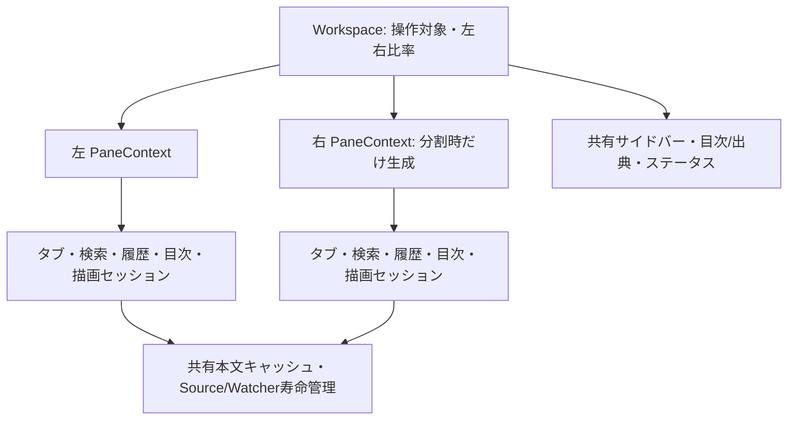

# 設計: Markdown文書の分割ビュー

ステータス: 完了

操作: `Ctrl+\`で分割、`Ctrl+Shift+\`で解除、`Ctrl+Alt+←/→`で操作対象を切り替える。タブの右クリックから反対側への表示・移動、文書リンク／検索結果の右クリックまたはShift+クリックから反対側への読込を行う。

UI表記: 未分割時は「右側に分割して開く」、分割済みでは操作元に応じて「左側で開く／右側で開く」と表示する。操作対象はタブ背景に隠れない上端の線で示し、キーボードフォーカスの枠と区別する。

## 現状の制約

| 現状                                             | 根拠となる実装                                 | 分割時に必要な変更                                     |
| ------------------------------------------------ | ---------------------------------------------- | ------------------------------------------------------ |
| 1組のタブ・ビューワー・目次                      | `routes/+page.svelte`                          | ワークスペース配下に最大2組のタブとビューワーを配置    |
| タブがアプリ全体で1つのactiveTabIdを持つ         | `stores/tab.svelte.ts`                         | ペインごとにタブとアクティブ状態を保持                 |
| 同じ文書は全タブから検索して既存を選択           | `actions/file-actions.ts`                      | 文書の重複判定を開き先ペイン内へ限定                   |
| 検索・履歴・目次・メタデータがsingleton          | `stores/*.svelte.ts`                           | 表示状態をペインへ帰属させ、共有パネルは操作対象を参照 |
| 描画のキャンセル世代がモジュール全体で1つ        | `markdown/engine.ts`                           | ペインごとの描画セッションへ分離                       |
| 本文キャッシュ削除は1タブのクローズに付随        | `stores/tab.svelte.ts`                         | 全ペインの参照を調べて最後の利用者が消えた時に解放     |
| 見出しの参照や印刷にdocument全体の要素検索がある | `TOCView.svelte` / `actions/export-actions.ts` | 文書のDOMルートと操作対象を明示                        |
| tabs.jsonはフラットなタブと検索1組               | `tabs-store.ts` / Rust `commands/app_state.rs` | バージョン付きのワークスペース形式と現行形式の移行     |

## 1. 状態の所有者

- `workspaceStore`をペイン構成の唯一の管理元とする。`paneIds`、`activePaneId`、`splitRatio`を保持し、追加・合流・移動を一つの操作として行う。
- 閉じたタブの履歴もWorkspaceが所有し、全ペイン合計で直近10件とする。元ペインID・タブ位置・文書記述・表示モード・位置のスナップショットを残し、ペインが消えても履歴を失わない。現行`createTabStore`内部の`recentlyClosed`はこの共有管理へ移す。
- `PaneContext`は安定した実行時IDと、`tabStore`、`historyStore`、`searchStore`、`tocStore`、`frontmatterStore`、`readingStatsStore`、アンカー要求、描画セッション、本文DOMルートを持つ。
- `Tab.id`を表示インスタンスIDとして使う。左右の同一文書は別のIDと表示状態を持ち、本文は既存の`documentKey(DocumentRef)`で共有する。
- `sessionUiStateStore`のタブIDによる位置保持を活かし、全ペインのタブIDを一意にする。
- テーマ、ズーム、フォント、レンダラー設定、Explorer、本文、索引、最近使った項目はアプリ全体で共有する。
- フロントマター・検索条件の検証等、起動時に必要な軽量処理からYAML解析・分割用UIの読み込みへ静的依存を広げない。

## 2. 構成と段階的な移行

- `WorkspaceView.svelte`が1〜2個のペインsection、タブバー、ビューワーと分割境界を配置する。
- 各ペインへ安定した`paneId`を渡す。`TabBar`、`MarkdownViewer`、`SearchBar`は`forPane(paneId)`で固定したストアを保持し、表示中に操作対象の変更へ追従させない。
- 外側の共有UI・コマンドには操作中のペインを参照する軽量なfacadeを提供する。facadeをビューワー内部やawait後の開き先決定には使わず、固定したストアと`OpenTarget`を渡す。
- 最初は1ペインで同じ構造に移行し、既存操作が成立した段階で2ペイン生成を有効にする。
- 2ペインでも別ウインドウ・別WebViewは作らない。既存のスコープ付きCSSとサニタイズを使う。

## 3. 開き先と非同期処理

- `openSourceMarkdown`等の文書を開く経路に開き先ペインを渡す。明示先がない場合は、操作を開始した時点の操作対象を解決する。
- 読込・確認ダイアログの前に`paneId`と要求IDを確定し、完了時には対象が存続し、要求が最新であることを確認する。
- 「反対側で開く」はリンクの解決・認可・サイズ確認の成功後にペイン生成／タブ追加を確定する。失敗・キャンセルでは元のタブ・構成・履歴を変更しない。
- 未分割時は未表示の生成予定IDとワークスペース構成の版を捕捉する。待機中に別操作で分割・解除された場合は再検証し、同じ操作の意図を保てない古い要求は破棄する。3つ目のペインや別操作で作ったペインへ暗黙に書き込まない。
- 各DOMイベントは発生元の`PaneContext`を渡す。右クリックで操作対象を更新しても、表示後のメニュー処理は捕捉した文書・DOMルートを使う。
- サイドバー検索、出典、Quick Open、CLI、DnD、最近使った項目、履歴、復元も同じ開き先指定へ統合する。複数ファイルは操作開始時の同じペインへ開く。
- `Ctrl+Tab`・数字キー・一括クローズは対象ペイン内のタブ順に従う。既存の入力ガードとの整合を保つ。
- 「反対側へ移動」の移動先に同じ文書がある場合は、移動元の表示モード・位置を移動先タブへ引き継ぎ、ピン留めをORで保持する。

## 4. 描画とDOMの分離

- `createMarkdownRenderSession()`でキャンセル世代を所有し、片側の開始・破棄が他方を中止しないようにする。
- Shikiの初期化PromiseとMarkdownItの設定別キャッシュは共有する。同じ構成の同時初期化はPromise単位でまとめ、失敗した初期化は再試行できるようにする。
- `activeRenderOptions`を同期`md.render()`直前に確定する既存規則は維持できる。非同期境界をまたいで可変設定を参照する実装にはしない。
- 片側の検索・Observer・プラグイン後処理・画像読込には、ペイン／表示インスタンスの世代と破棄状態を関連付ける。
- 文書の論理アンカーとDOM上のIDを分離する。見出し・脚注・本文内IDと参照属性をペイン／表示インスタンスで名前空間化し、SVG内のID参照も整合させる。
- 目次・内部アンカー・検索はそのペインのDOMルートから探索する。`referenceId`等に論理アンカーを保ち、コピーしたリンクやHTML出力へペイン用IDを混入させない。
- カスタムCSSも同じ論理IDを扱う。検証済みCSSを構文として解析し、各表示ルートに限定したスタイルを生成する。`#intro`等のIDセレクターは対応するDOM IDへ変換し、属性`id`のセレクターはDOM要素に保持する元の論理ID属性へ対応付ける。ID・属性セレクターの詳細度、CSSエスケープ、結合子、疑似クラス内のセレクターを保ち、文字列の一括置換はしない。
- カスタムCSSの`url()`・`@import`拒否と既存のサイズ上限を先に適用する。解析結果はCSS更新単位で共有し、表示ごとの出力は最大2つとし、表示破棄時に解放する。名前空間化後のIDだけを前提に利用者へCSSの書き直しを要求しない。通常表示・同じ文書の左右表示・印刷の回帰テストを必須とする。
- Mermaidの既存の一意な描画IDを維持し、遅延完了・タイムアウト後に他方の図や新しい表示を変更しない。
- 画像の許可は同じDocumentKeyに対する既存の承認単位を共有する。許可変更の通知は両側へ伝え、件数・読み込み表示はペインごとに保持する。

## 5. 本文・watcher・Sourceの寿命

- 全ペインのタブを列挙する共通の文書利用管理を用意し、クローズ・合流・複製・移動・復元から利用する。
- 同じDocumentKeyの本文キャッシュは、最後のタブがなくなるまで削除しない。
- watcherは既存の`nativeDocumentIdentity`／ZIPコンテナーの同一性判定を使い、全ペインとExplorerの利用状態から必要性を判断する。
- ペイン間の移動・重複統合は、参照を減らして一旦解放する処理にしない。移動後の構成を確定してから不要な資源を調べる。
- ファイル更新はDocumentKeyごとに読み込みをまとめ、各タブの世代・Source世代を照合して反映する。異なる安全状態の表示を勝手にリッチ表示へ切り替えない。
- ZIPは両側のタブとExplorerから使われなくなった場合だけwatcher・Sourceを解放する。再読込は既存のSource別直列キューを再利用する。
- 履歴・閉じたタブからの再読込は既存の認可・サイズ確認を通す。保存したSource情報を権限として扱わない。

## 6. 共有パネル・印刷

- 目次・メタデータ・出典・リンク一覧は操作中のペインの文書と表示状態へ追従する。非アクティブ側の描画完了で共有表示を上書きしない。
- リンクプレビュー、ライトボックスはウインドウに各1つで、発生元のペイン／表示インスタンスを捕捉する。元の表示の破棄・切替で閉じる。
- リンクグラフのコンテキストに有界な`paneId`を含め、同じ文書を表示したペインへの切替でもコンテキスト版を更新する。Rust DTOとフロントの対応を揃え、古い版の開く要求は破棄する。既存の文書アクセス検証は維持する。
- 印刷・PDFは対象ペインのルートだけを印刷対象にする。HTML・図の出力も対象のルート／描画結果を渡し、先頭の`.markdown-body`を取得しない。

## 7. リサイズと狭幅の推奨案

- 初期50:50、保存比率20〜80%、読みやすさの目安は各280px。境界操作の実効範囲を現在の中央幅で制限する。
- 分割時はウインドウ幅に加えて、サイドバー・目次を引いた中央領域の幅で目次のドロワー化を判断する。
- 2ペイン分の幅を確保できない場合は、ペイン構成・保存比率を変更せず、操作中側のビューワーだけを描画する。左右切替UIを表示し、幅が戻れば元の比率を使う。
- 最小幅・境界幅・切替閾値は定数化し、閾値付近のリサイズで表示が往復しないよう測定元を固定する。
- キーボード操作、フォーカス表示、区切りの読み上げ、TOCドロワーのフォーカス復帰をテストする。

## 8. セッション形式

- `tabs.json`に`schemaVersion: 2`と`workspace`を導入する。アプリ全体の`explorer`・`expandedDirs`は同じファイルへ残す。
- `workspace`は1〜2個の`panes`、`activePaneIndex`、`splitRatio`を持つ。各ペインは`tabs`、`activeIndex`、`search`を持つ。
- 各タブは既存のSource記述・文書相対パス・ピン留め・モード別位置に`viewMode`を加える。実行時のペイン／タブIDは保存せず、復元時に再発行する。
- `renderMode`とリッチ表示の承認は永続化せず、現行のサイズ確認とセーフモードを優先する。
- 現行のフラットな形式は1ペインへ移行する。既存に`viewMode`がなければレンダリング表示を既定にする。
- 1〜2ペイン、タブは合計100件までとし、開く・複製時にも上限を確認する。保存総量1MiB・Explorer展開数・検索語長等の既存上限を維持する。
- Rustの`validate_state`とフロントの復元処理の両方に、形式別の型・数・比率・インデックス検証を設ける。片側の文書を復元できない場合は有効な側を残す。
- 不明な将来形式は実行可能な情報として解釈せず、既存の復元確認／破棄フローで扱う。確認前に空状態で上書きしない。
- DOM、検索結果、描画HTML、リンク索引、ナビゲーション履歴、閉じたタブ履歴、TOCドロワーの開閉は保存しない。

## 9. 検証と実装順

1. 状態・寿命管理を1ペインで移行し、既存451件のテストと既存スモークを通す。
2. 論理ID・DOM ID・カスタムCSSの対応を小さいfixtureで成立させてから、2ペインの表示・タブ・独立描画・対象指定を実装し、同一文書と競合のテストを追加する。
3. 共有パネル・リンク・出力・復元・狭幅動作を統合する。
4. 実WebView2でNative/ZIP、左右同一文書、同時描画、片側クローズ、ZIP更新、復元、ショートカット、印刷対象を確認する。
5. `format/lint/check/test`、Rust検査、`perf:ci`、本番フック不在、依存監査を実施する。サイズ予算の変更は本specに含めない。
6. 独立した設計差分・セキュリティレビュー後にコミット／PRへ進む。
